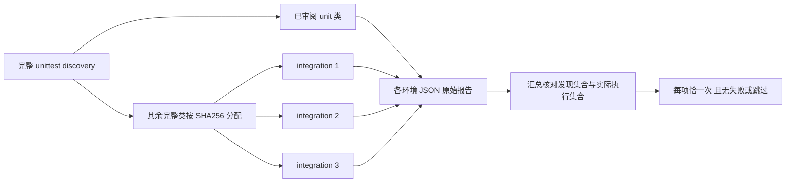

# R15：测试分层、并行执行与完整覆盖门禁

日期：2026-10-14。状态：本项完成。[PR #76](https://github.com/CoderDongHuang/InfoPulse/pull/76) 的最新 head `048b4fa` 通过 [Release Gate 38550460396](https://github.com/CoderDongHuang/InfoPulse/actions/runs/38550460396) 和 CodeQL 全部门禁；改指向 main 后已测试的合并提交保持不变，正常合并提交 `4ce7a9b`。CI 覆盖制品核对 Linux 3.11、Windows 3.10、Windows 3.11 各 **237/237**、四组、每项恰一次。后续 R16 新增一项，完整集合增至 238，不能混同两个历史时点。

## 原因与分类

R11 将 Windows job 预算增至 45 分钟，解决了完整回归被取消的问题，但没有缩短反馈时间。历史 Windows 单测试阶段 217 项耗时 1702.129 秒；不同硬件、依赖、测试数量的耗时不能直接当作优化对照实验。

新 runner 每次发现完整测试集合，将人工审阅的无数据库/文件夹具类归为 unit，所有未分类新测试默认 integration。含数据库或 HTTP fixture 的类整体保留在集成层，不能因方法短就称为单元测试。以完整类名 SHA256 固定分到三个集成分片，同类保持一个进程、方法顺序保持稳定。

R15 验收时 237 项：unit 55、integration-1 49、integration-2 59、integration-3 74。新增六项门禁测试覆盖确定性、类归属、发现失败/重复/过期分类、漏跑/skip/expectedFailure、缺失环境/分片和伪覆盖；新测试随 discovery 自动加入，数量不是 runner 的硬编码目标。

## CI 结构

| 环境 | Python | 每次运行 |
| --- | --- | --- |
| Linux | 3.11 | unit + 三个 integration 分片，共 237 项 |
| Windows | 3.10 | unit + 三个 integration 分片，共 237 项 |
| Windows | 3.11 | unit + 三个 integration 分片，共 237 项 |



12 个回归 job 不共享数据库或文件目录，各自完整安装和 pip check。原 Linux/Windows 安装、编译、契约、SQLite 往返与配置检查保留；PostgreSQL 双版本迁移/worker/产品浏览器与两种容器 e2e 仍独立运行。没有拿 SQLite 分片替代跨数据库验收。

每个 runner 先写 completed=false 的完整 inventory/分区/计划；完成后保存实际执行 IDs、逐项耗时、错误、失败和跳过。发现失败、分类过期、空选择、重复 ID、执行不全、skip、expectedFailure 均不能通过。汇总要求每个指定环境四份报告齐全、发现及分区完全一致、执行集合恰好覆盖所有发现项一次。下载失败或缺失制品同样失败。

## 本机复现

在 backend 使用隔离测试配置：runner 禁止读取个人 .env，清理应用设置环境变量，关闭后台 worker 和 crawler，使用临时存储。各集成测试自行创建临时数据库。首次导入发现所有模块有启动成本，unit 秒数仅记录实际测试阶段，不含安装与 discovery。

```powershell
python scripts/test_suites.py --suite unit --output ../acceptance-artifacts/test-layers/local-unit.json
python scripts/test_suites.py --suite integration --shard-index 1 --output ../acceptance-artifacts/test-layers/local-integration-1.json
python scripts/test_suites.py --suite integration --shard-index 2 --output ../acceptance-artifacts/test-layers/local-integration-2.json
python scripts/test_suites.py --suite integration --shard-index 3 --output ../acceptance-artifacts/test-layers/local-integration-3.json
python scripts/verify_test_reports.py --reports ../acceptance-artifacts/test-layers --environments local --output ../acceptance-artifacts/test-coverage.json
```

四组可在独立终端并行。`--suite all` 保留完整串行复现；`--list-only` 仅输出计划，completed=false，不能作为测试通过证据。原 unittest discover 仍可用，不在测试代码里增加生产功能开关。

## 实验结果与限制

Windows Python 3.10 四组全部通过，无 skip 或 expectedFailure，汇总核对 **237/237** 恰好一次：unit **55/55**（0.035 秒）、integration-1 **49/49**（296.694 秒）、integration-2 **59/59**（495.463 秒）、integration-3 **74/74**（398.742 秒）。三个集成进程同时启动，最长测试阶段约 8.26 分钟；这不是包含安装和 discovery 的总时长，也不是与历史 hosted runner 的同机对照。

YAML 解析确认 12 个回归组合、汇总依赖和现有双产品/双容器矩阵完整保留；编译、差异和 **15 份 Markdown / 102 个本地链接**校验通过。原始 JSON 保存于验收制品，CI 继续独立记录三环境实际结果。

当前 SHA256 仅保证分配稳定，尚未按历史耗时平衡；新类加入可能导致某片变慢。CI job 最大预算暂留 45 分钟，需积累新分片统计再收紧。安装重复增加总计算成本；并行优化不表示总 CPU 时间变少。

并行隔离可能改变历史全量进程的共享状态顺序，实际运行及三环境 CI 是必要验证。没有覆盖所有业务按钮、真实提供商、其他 worker 恢复或跨域业务 fixture，路线图对应条目仍保持待完成。
