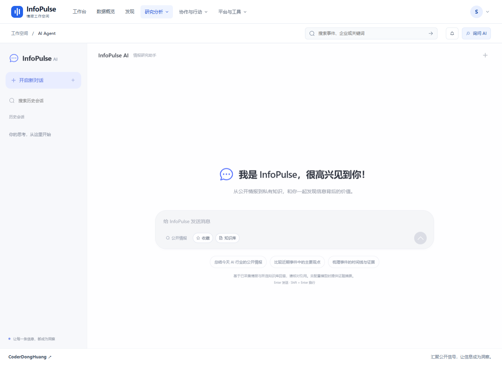
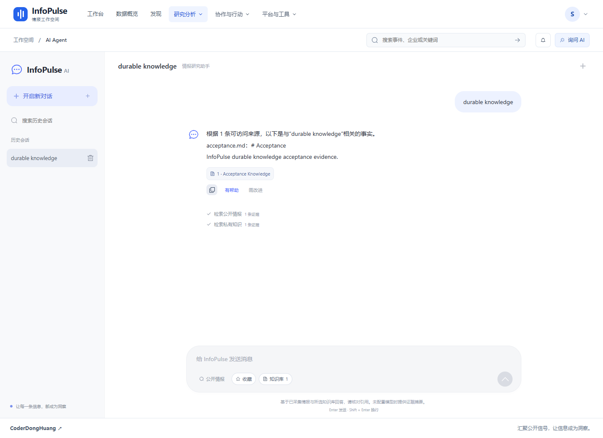
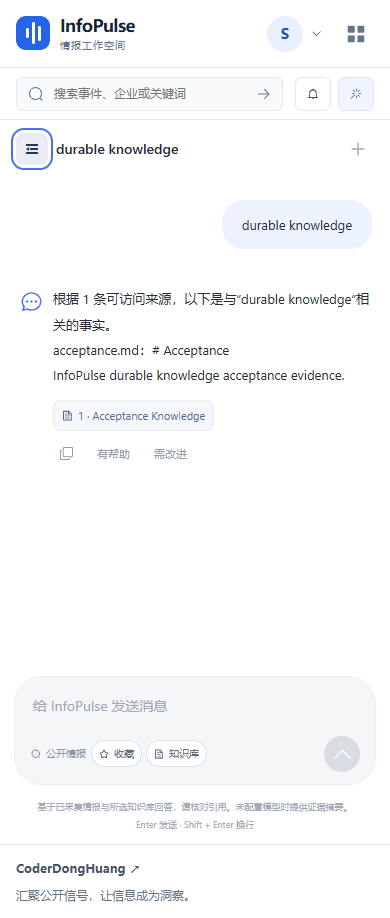

# 2026-10-17：导航图标与 AI 对话界面

## R22：头像菜单与导航图标（完成）

- [x] 个人中心使用 User 图标，与退出登录的 SwitchButton 图标保持一致。
- [x] 补齐 12 个 Element Plus 图标注册，覆盖桌面分栏菜单、移动导航及管理员入口；不引入额外图标库。
- [x] 单元测试验证所有导航图标均为真实包导出且已注册，而不是没有内容的自定义标签。
- [x] 前端 43 项测试、类型检查、生产构建和资源预算通过。
- [x] Edge 产品回归 12/12 通过，包含 36 路由、全部普通用户导航 SVG、个人中心 SVG、键盘焦点恢复及 320/390/768/1024px 移动布局。

浏览器测试初次暴露菜单退出动画期间两个弹层同时存在的定位竞争；测试改为等待旧弹层完全消失，再打开下一菜单，最终全量复测通过。测试未改变菜单动画或放宽 SVG 断言。

本机证据：`acceptance-artifacts/r22-product/result.json`（忽略提交的验收产物）。测试使用 15173 → 18080 隔离环境，没有向公众使用数据库写入夹具。

## R23：DeepSeek 风格对话工作区（完成）

- [x] 浅灰历史侧栏、白色主画布、蓝色单一强调色、居中欢迎区、胶囊输入框与圆形发送/停止按钮；保留 InfoPulse 品牌，不复制第三方商标。
- [x] 输入框自动增高，Enter 发送、Shift + Enter 换行；中文输入法确认候选词不会误发送，输入限制与后端 8,000 字上限一致。
- [x] 历史会话搜索、新建、选择、删除确认与取消；欢迎页只读取数据，不再进入即写入空会话。从欢迎页直接提问时，以首个问题前 40 个字符命名。
- [x] 保留真实公开情报、收藏上下文、知识库选择、引用抽屉、回答复制及点赞/负向反馈；失败反馈不显示成功。
- [x] 兼容 320/390/768/1024/1440px；手机历史抽屉可用 Escape 关闭并恢复按钮焦点，无横向溢出。
- [x] 网络失败、服务端失败、同步异常均释放发送状态并保留输入；停止生成明确标记未完成草稿。
- [x] 流式响应绑定会话和请求代次；切换会话、停止及卸载后丢弃迟到响应，防止回复串入其他会话。详情读取同样防止乱序覆盖。
- [x] `/agent` 的会话 query 更新不会重建整个页面，保留当前流式连接；其他页面仍按原 fullPath 生命周期处理。
- [x] 引用外链限定无用户名/密码的 HTTP(S) URL，并使用 `noopener noreferrer`；回答仍按纯文本渲染，不执行模型输出的 HTML。

### 验证证据

| 层级 | 结果 | 验证内容 |
| --- | --- | --- |
| 前端单元测试 | 56/56，无跳过 | 新增 13 项控制器测试：输入法、URL、单次创建、上下文、终态、失败恢复、停止、切换、详情乱序、知识库故障隔离、删除失败、卸载 |
| 类型与构建 | 通过 | `vue-tsc`、Vite 生产构建、首屏资源预算；依赖中原有 PURE 注释警告不影响构建 |
| Edge 产品验收 | 13/13 | 36 路由与原有链路；新增真实知识检索 SSE、引用、反馈、剪贴板复制、刷新、历史搜索/选择、删除取消/确认、移动端 |
| 故障夹具 | 通过 | 浏览器仅对指定消息请求注入断网和阻塞，验证输入恢复及停止；不伪装成真实模型回答 |

本机最终产物位于 `acceptance-artifacts/r23-product-final/result.json`。使用隔离环境中上传的 `acceptance.md` 做真实检索，持久化消息与引用通过独立 HTTP 读取核对。首次浏览器验收发现所有历史标题均为“新会话”，增加首问命名后复测通过；最终新增复制与搜索断言后再次全量通过。

可重复运行：

```powershell
cd frontend
npm test
npm run build
cd ../backend
.\.venv-audit\Scripts\python.exe -m scripts.product_smoke --base-url http://127.0.0.1:15173 --output ../acceptance-artifacts/r23-product-final --browser-channel msedge
```

### 界面预览

以下截图来自隔离验收账号。`Acceptance Knowledge` 和 `acceptance.md` 是明确标注的测试资料，不是向普通用户环境注入的演示数据。







### 能力边界与后续方向

界面参考 DeepSeek 的布局和交互语言，不代表接入了 DeepSeek 模型。没有模型密钥时仍使用现有的可引用证据摘要，不提供虚假的“深度思考”开关。“公开情报”指本机已采集的数据，不是即时全网搜索。停止只中断本浏览器连接，不声称能撤销已经完成的服务器工作。

- [ ] 会话自动命名覆盖手动新建后的首问、重命名和按日期分组。
- [ ] 长历史分页/虚拟列表、滚动位置保留及可配置字号。
- [ ] 经消毒的 Markdown/代码高亮；当前纯文本路径优先确保输出安全。
- [ ] 服务端生成取消确认、多标签页协同和中断恢复协议。
- [ ] 用户自行配置模型后的真实模型质量与长上下文专项评测。
