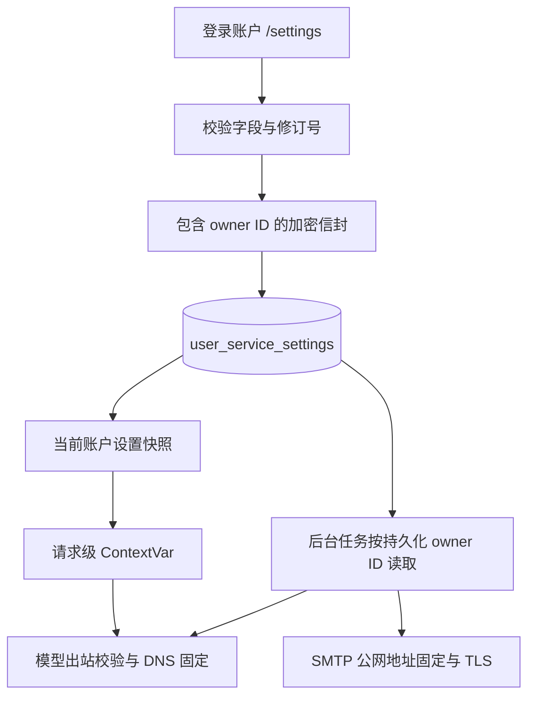
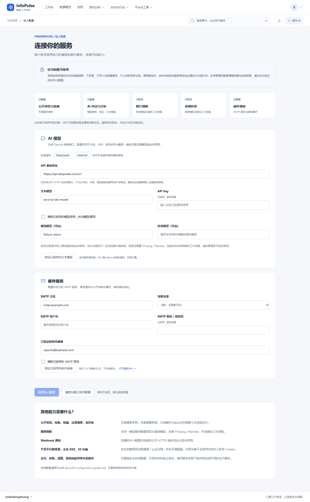
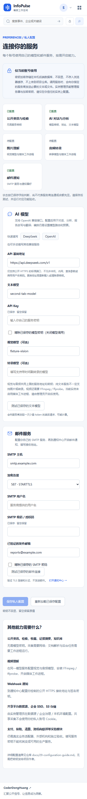

# R24：私人配置中心设计与验收

日期：2026-10-18。状态：本机实现与专项验收完成；跨平台结果以本 PR 的 Release Gate / CodeQL 为准。本次新增 `/settings`，不是“全部模块进入稳定版”的声明。

## 使用目标与范围

使用者克隆项目并在自己的实例运行，注册账号后从右上角头像进入“私人配置”。公开数据采集、检索、收藏、知识检索及无模型日报无需服务密钥；需要 AI 或邮件时，才保存自己的服务信息。服务商名称、模型权限、余额、网络和已验证发件身份由使用者自行准备，无需向项目作者提供密钥。

| 能力 | 个人配置 | 额外条件 |
| --- | --- | --- |
| 文本对话、分析、改写、翻译 | HTTPS API 基础地址、文本模型、API Key | OpenAI 兼容协议、可用额度；编排另有模型路由与预算 |
| 图片理解 | 同一提供商下的视觉模型 | 提供商支持图片输入；媒体 worker |
| 音频/视频 | 同一提供商下的时间戳转录模型，视频另需视觉模型 | 媒体 worker；视频需要 FFmpeg/ffprobe |
| 邮件通知 | SMTP 主机、465/587、用户名/授权码、已验证发件邮箱 | 通知中心开启邮件、填写接收地址；调度与通知 worker |
| 共享数据源、对象存储、企业身份 | 不属于个人模型表单 | 管理员按实例和租户配置、独立验收 |

DeepSeek/OpenAI 按钮只填入公开地址和模型示例，不替使用者创建账户或购买服务。视觉/转录共用一个模型地址与密钥，文本服务配置成功不证明其支持多模态。

## 设计与数据流



不把单例模型客户端在多个用户间切换。每次请求绑定独立的 Settings 快照，每次模型调用构造并关闭自己的客户端；流式响应完成前上下文继续有效。后台媒体任务、编排 run 和邮件通知使用数据库中的所有者身份，不能继承恰好触发调度的 HTTP 用户配置。

关键约束是“执行者配置来自已验证的账户所有权”，例如：

```python
# 生产实现见 app/services/service_settings.py 与 core/runtime_settings.py。
settings = await owner_settings(db, task_owner_id)
with use_settings(settings):
    result = await complete_chat(system_prompt, user_prompt)
```

新版本的个人执行**不继承实例级 LLM/SMTP 凭据**。这是有意的迁移变化，避免用户注册后自动花费部署者的模型余额。既有用户需要在私人配置中重新填写。后台任务开始时读取最新保存配置；已经开始的调用保持自己的快照。

## 密钥生命周期与出站约束

1. 使用独立的 `PLATFORM_ENCRYPTION_KEY`，至少 32 字符且不能与 JWT 密钥相同。本地公开数据启动器自动生成并持久化，手动部署需自行设置。
2. 全部私人配置作为 Fernet 信封加密后入库，信封包含 owner ID，拒绝将其他账户的密文行换入当前账户。
3. GET 只返回普通字段、revision 与密钥是否已配置，密钥不回显；浏览器 localStorage/sessionStorage 不保存服务密钥。
4. 密码框留空表示保留；显式勾选清除才删除。修改服务目标必须重新输入或清除已有凭据，不能把保留的密钥转发到新地址。
5. `revision` 通过数据库条件更新防止多标签页覆盖；首次创建由主键防止双写，冲突返回 409。
6. 每次模型请求重新验证公网 DNS 并固定连接 IP，保留原始 Host 与 TLS SNI；禁止重定向、环境代理、私有/回环地址及非 HTTPS 地址。响应流上限为 8 MB，调用有超时预算。
7. SMTP 仅支持 465 TLS / 587 STARTTLS，先验证并固定公网地址，再按原域名校验证书，完成 TLS 后才认证。连接测试只执行握手/认证/NOOP，不发送邮件。
8. 服务商异常不会原样呈现在页面或通知错误记录中；模型测试可能产生少量费用，保存配置本身不会调用服务商。

这属于服务端加密存储，不是端到端加密或对服务器管理员保密。拥有服务器和主密钥的人有能力解密；实际模型调用会把必要文本、图片或音频发给使用者指定的服务商。数据库和 `.public-local/runtime.json` 必须一并备份，不能只保留其一。

## 页面与失败恢复



截图来自隔离验收账户；`fixture-vision`、`second-tab-model` 和 example.com 邮箱是测试数据，并非可复制使用的生产配置。顶部“已配置”只表示字段存在，不表示连通、余额或模型能力已验证。截图中媒体 worker 关闭，页面据实显示对应能力待配置。



断网保存保留输入并允许重试；409 冲突要求重新加载；主密钥缺失或变更给出配置错误，不偷偷回退为全局密钥。显式由页面处理的错误不再重复弹出通用 Axios 错误消息，401 的刷新与退出逻辑保留。

媒体 worker 若无法读取任务所有者配置，会回滚、记录失败并释放 lease，不调用提供商，也不把任务永久留在 running。该范围不包括进程被 kill 后的所有 lease 恢复情形。

## 本机验证记录

| 检查 | 结果与边界 |
| --- | --- |
| 私人配置 15 项 + 媒体失败 8 项 | 23/23，215.669 秒；真实文件 SQLite、真实 ASGI、双账号、密文绑定、并发保存、上下文隔离和失败释放 |
| SDK/传输 | 使用实际 OpenAI SDK + MockTransport 断言各账号地址/密钥/模型和关闭；公网 DNS/SNI、响应大小；不访问付费提供商 |
| SMTP/邮件 | 验证通知所有者选择、错误脱敏、465/587 IP 固定和 TLS 先于认证；使用受控传输替身，不宣称真实邮件送达 |
| 模型预算/多模态/编排既有回归 | 18/18；全球智能/工作流/认证事务/资料事务 16/16 |
| 前端 | 57/57；TypeScript、Vite 与 bundle budget 通过，入口 JS 512,520 B / gzip 176,099 B，CSS 134,119 B |
| API 契约 | 356 路径通过；本次新增配置和连接测试两个路径，快照同步 |
| SQLite 迁移 | 隔离临时数据库从空库升级 head、降级到 0034、再升级 head 成功；没有操作用户数据库进行降级 |
| Edge 产品验收 | 14/14；36 路由外壳及私人配置交互；保存/重载/密钥不入浏览器存储、断网保留、失败测试、409、清除、320/390/768/1024/1440 布局，无页面/组件/服务器错误 |

浏览器报告：`acceptance-artifacts/r24-private-settings/result.json`。浏览器通过拦截注入模型测试失败，绝不把假密钥发送到真实提供商。路由外壳巡检不等于所有业务按钮验收。服务器运行于本机 18080、前端 15173，均为隔离验收环境。

Edge 最小化问题已由用户确认恢复，本次未添加窗口置顶/焦点控制或系统设置变更。

## 完成与后续工作

- [x] 头像与个人中心入口、私人配置 UI、说明与保存/测试/清除。
- [x] 加密持久化、账号隔离、修订冲突、出站限制、敏感错误隐藏。
- [x] 请求及后台任务读取各自所有者配置；迁移、契约和文档同步。
- [x] 本机后端专项、前端构建及 Edge 产品回归。
- [ ] 使用用户自行提供的真实 LLM/SMTP，验证文本、图像、转录及最终邮件送达；不把 MockTransport 通过当作提供商验收。
- [ ] 多提供商分开授权、按能力选模型、额度上限及计费可见性。
- [ ] 加密主密钥版本化、在线轮换和带数据备份恢复演练。
- [ ] 管理员可控的本地模型/内网代理白名单，不直接放宽当前公网限制。
- [ ] PostgreSQL 私人配置带数据迁移与并发专项、媒体/编排进程中断恢复。
- [ ] 全部核心按钮的负向验收、实验模块隔离和真实业务适配器。

详细用户操作见 [配置指南](../29-configuration-guide.md)，整体边界见 [能力矩阵](../32-capability-matrix.md)。
