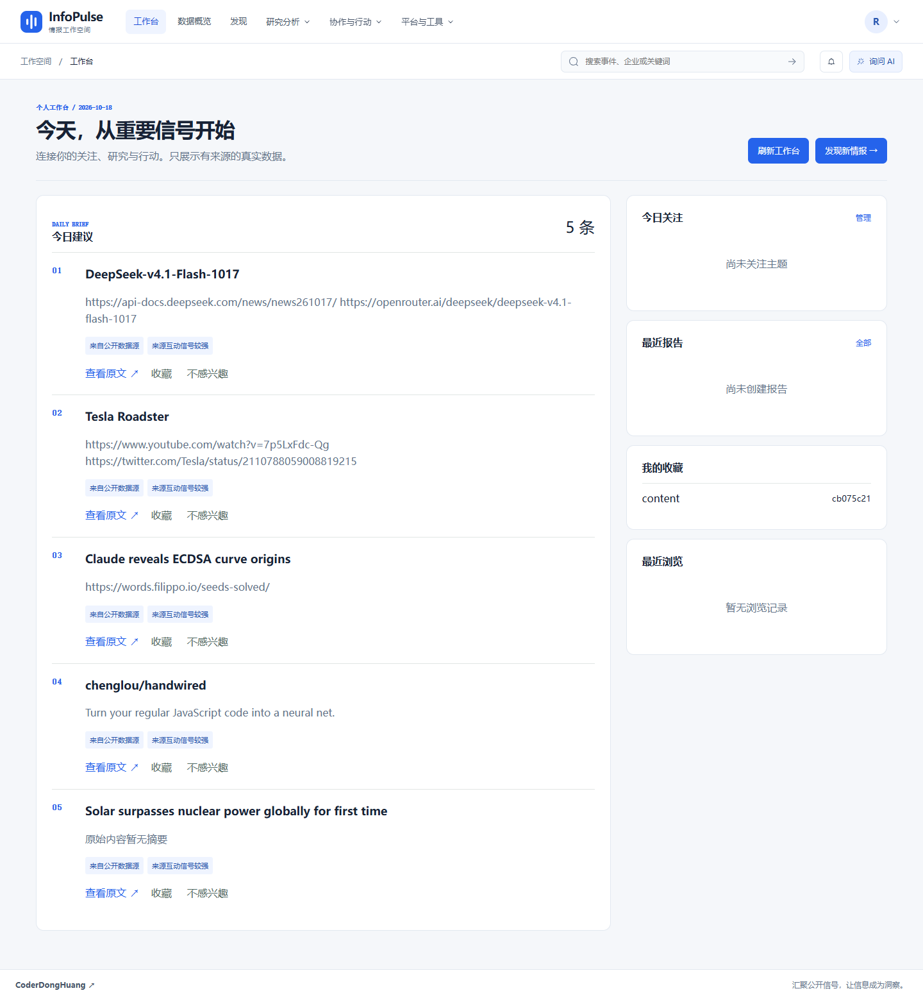
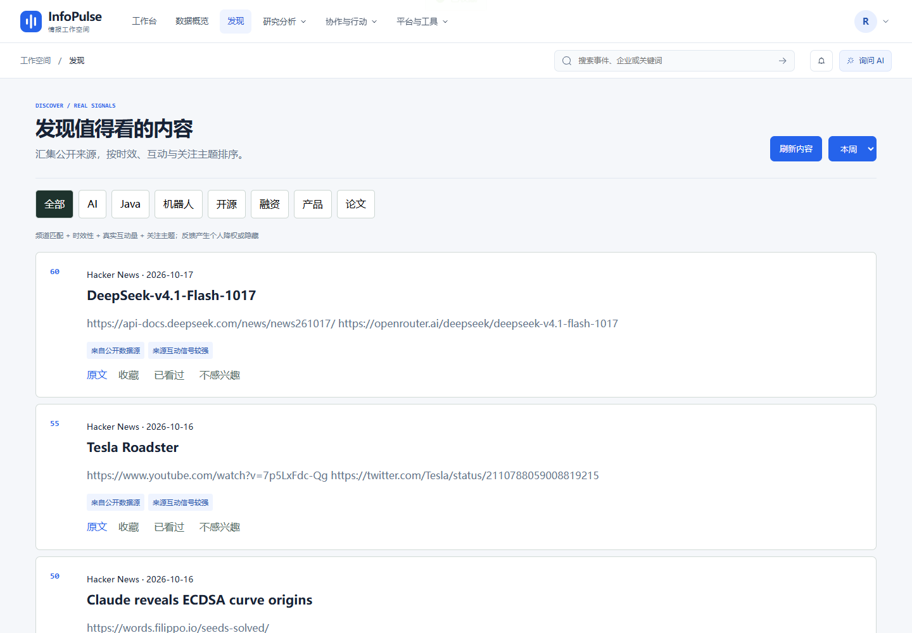
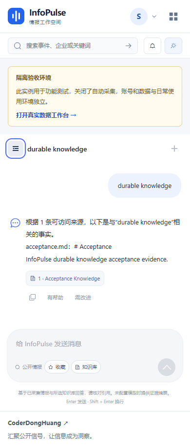

# R28 公开数据入口与空状态澄清

状态：已完成下述范围。验收日期：2026-10-18。

## 问题与证据

用户在发现页／工作台没有看到资讯，并确认使用地址 `http://127.0.0.1:15173`。本机同时运行两套独立实例：

| 入口 | 后端 | 用途 | 数据与账号 |
| --- | --- | --- | --- |
| 15173 | 18080 | 隔离浏览器验收，自动公开采集关闭 | 验收库与测试账号 |
| 15174 | 18081 | 本地日常使用，真实公开源周期采集 | `.public-local/` 内的持久化数据，独立注册账号 |

因此，本次现象不能据此判断检索算法失效。真实实例当次已存储 321 条内容；Hacker News、GitHub、DEV、arXiv 的最近同步均成功。没有向日常数据库注入 fixture，也没有复制测试账号或密钥。

## 修改

- `/api/v1/health` 返回布尔值 `acceptance_mode`，普通服务默认 `false`；隔离验收启动脚本显式设置为 `true`。
- 前端依据后端标记显示「隔离验收环境」，登录前后都能看到；只有本机标准验收端口 15173 才提供同主机 15174 的跳转链接，其他部署提示按 README 启动。标记不由端口猜测，探测失败不阻断登录和页面重试。
- 发现页增加「刷新内容」，工作台增加「刷新工作台」。它们重读现有 API，不触发管理员采集操作。加载中禁用刷新；发现页保留频道／时间条件并返回第一页。
- 修正空状态说明：工作台推荐来自最近一周，不是仅当日；首次同步、筛选条件及个人反馈均可能影响结果。
- 聊天区域按提示之外的剩余屏幕高度布局，避免手机上的提示把输入框挤出视口。
- README 明确两个入口、账号隔离和首次同步后的操作。

## 实际运行结果

| 检查 | 结果 | 边界 |
| --- | --- | --- |
| Edge 完整产品验收 | 14/14，通过；无页面异常、组件错误和 HTTP 5xx | 包含真实知识库、会话、设置、认证及 36 路由；路由检查不等于所有实验功能完成 |
| 公开数据浏览器 canary | 7/7，通过 | 注册、周期采集记录、关键词检索与详情、收藏、工作台、日报任务及站内通知 |
| 两个刷新按钮 | 点击后 API 200，真实内容继续可见 | 不依赖模型密钥 |
| 后端专项回归 | 11/11，通过 | 环境标记、检索与公开数据测试 |
| 前端回归与生产构建 | 57/57，通过；类型检查与包体门禁通过 | JS gzip 176,557 字节，CSS 134,493 字节 |
| API 契约 | 356 路径通过 | 未改变已有接口结构约束 |

实时数据会继续更新，321 仅是此次验收快照。每源最新记录如下：

| 数据源 | 拉取 | 新增 | 更新 | 跳过 | 状态 |
| --- | ---: | ---: | ---: | ---: | --- |
| Hacker News | 30 | 2 | 25 | 3 | succeeded |
| GitHub | 30 | 0 | 19 | 11 | succeeded |
| DEV | 30 | 4 | 2 | 24 | succeeded |
| arXiv | 30 | 0 | 0 | 30 | succeeded |

跳过可能表示重复或没有变化，不等于采集失败。可核对的实际样本来自 Hacker News：

> Kids are outsmarting social media bans. That's not a problem we need to solve

[原始来源](https://www.technologyreview.com/2026/10/16/1146834/kids-are-outsmarting-social-media-bans-thats-not-a-problem-we-need-to-solve/)。

## 界面证据

以下为真实浏览器截图，图片独立存放于 `docs/blog-assets/2026-10-18/`。公开实例截图使用验收创建的普通读者账号；隔离聊天截图中的 `acceptance.md` 是专用测试资料。







## 复验

按 README「本地真实公开数据」启动后，在项目根目录执行：

```powershell
cd backend
.\.venv-audit\Scripts\python.exe -m scripts.public_data_smoke --base-url http://127.0.0.1:15174 --output ../acceptance-artifacts/public-data
```

以上使用本次本机虚拟环境路径；其他使用者替换为自己的 Python。该 canary 会创建普通读者、收藏及日报任务，验收后暂停其任务；它不写虚构资讯。需要本机浏览器与 Playwright 依赖，详见脚本和公开使用记录。

隔离产品脚本 `scripts.product_smoke` 会写 fixture，只能针对单独验收实例运行，禁止指向日常数据库。两类证据应分别保留。

## 尚未覆盖

本次未配置付费模型或 SMTP，不声称这些外部提供商已经验收。公开源单次健康不保证长期可用，限流、网络错误、长期采集质量及恢复演练仍在路线图内。日常实例保持自托管 beta 定位；不将空库填充模拟数据，也不把实验模块标记为全部完成。
