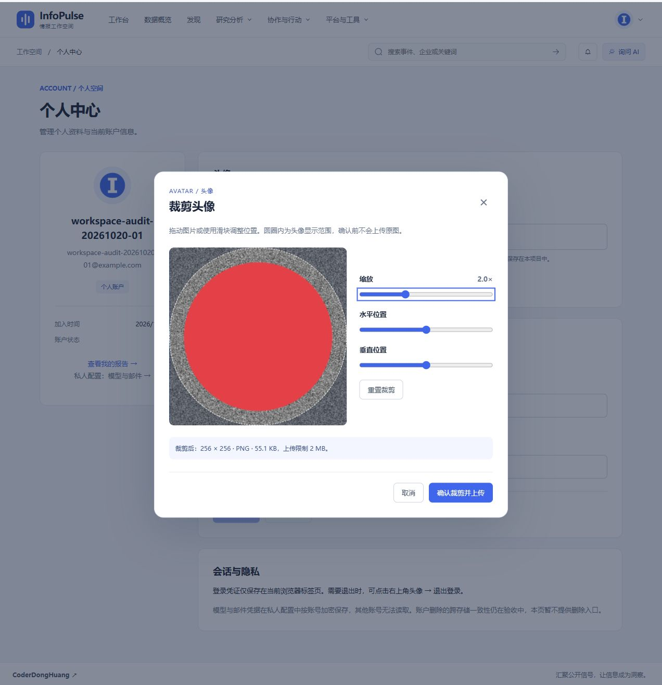
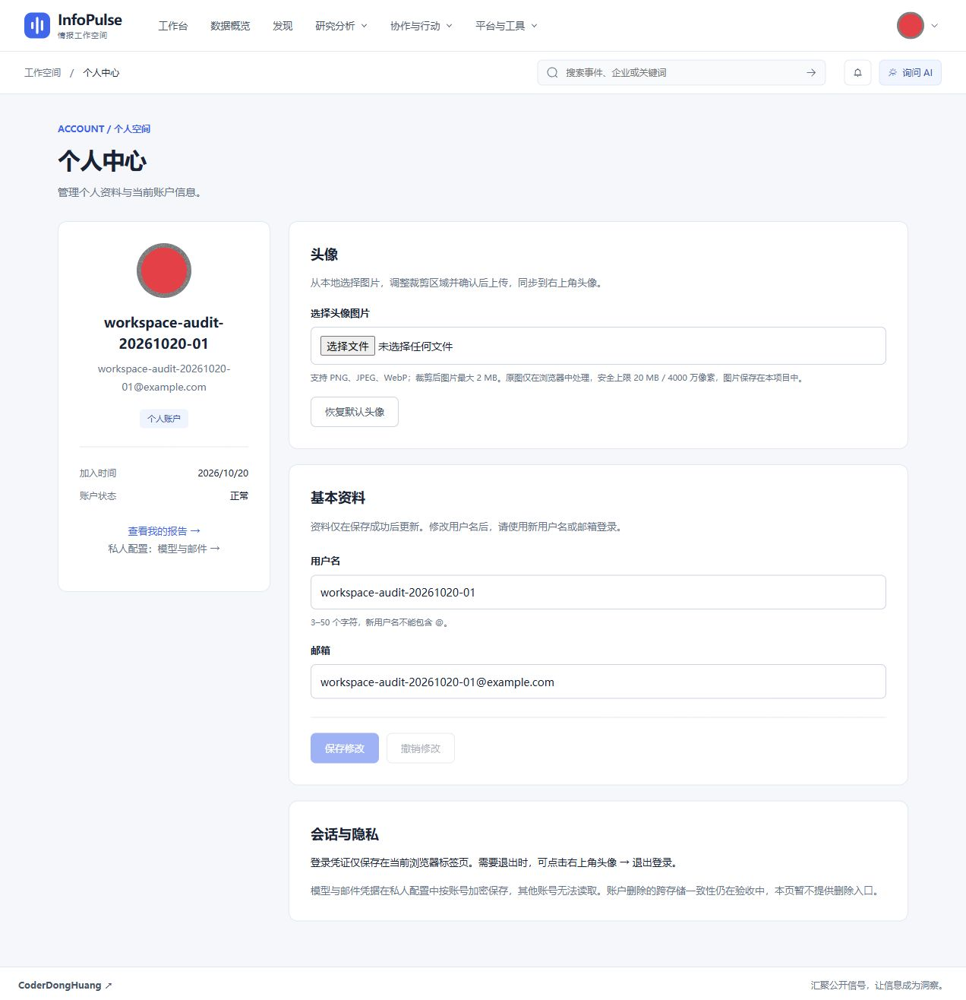

# R33：先裁剪头像，再校验上传大小

日期：2026-10-20。范围：个人中心本地头像裁剪与上传，延续 [R32](./2026-10-20-local-avatar.md)。

后续更新：[R34](./2026-10-20-avatar-simple-controls.md) 已将三个滑块替换为滚轮缩放与鼠标拖动，并缩小弹窗。本文截图及 74 项测试数保留为 R33 阶段记录；文件大小与安全限制不变。

## 已完成

- [x] 上传流程改为“选择原图 → 调整裁剪 → 显示结果大小 → 确认上传”。选择文件时不再按头像的 2 MiB 上传限制拒绝原图。
- [x] 原图只在浏览器本地解码与裁剪；服务端收到的仅为裁剪后生成的 `avatar.png`。
- [x] 提供方形预览、圆形头像参考线、拖动、1–4 倍缩放、水平/垂直位置滑块与重置。
- [x] 输出 256 × 256 PNG，按照实际编码后的 `File.size` 校验 2 MiB（界面显示 2 MB），确认前显示实际 KB 数。
- [x] 原图另设 20 MiB 文件安全上限与 4000 万像素解码后检查；这些是资源保护条件，不是头像上传大小限制。支持 PNG、JPEG、WebP。
- [x] 编码完成前禁止确认；快速调整仅采纳最后一轮编码结果，避免旧结果覆盖新裁剪。
- [x] 取消、关闭按钮和 Escape 不触发上传；可再次选择同一个文件。上传失败保留裁剪弹窗，允许重试；上传期间禁用调整与关闭。
- [x] 关闭时释放原图对象 URL；服务端沿用认证、格式解码、尺寸/大小检查与元数据清除，不依赖客户端校验保证安全。

## 实现

`frontend/src/utils/avatarCrop.ts` 分离原图安全校验、裁剪坐标计算、Canvas 绘制和 PNG 编码。`AvatarCropper.vue` 管理本地交互与编码状态；`ProfileView.vue` 仅在用户确认后调用既有头像上传接口。无需新增依赖、接口或数据库迁移；首次安装仍须应用 R32 的 `0036` 迁移。

```text
本地原图 ──安全检查──> 预览/缩放/移动
                          │
                          ▼
                   256 × 256 PNG 编码
                          │
                 校验实际结果 ≤ 2 MiB
                          │
                      用户确认
                          ▼
                原有认证头像上传与持久化
```

## 测试与页面验收

- 前端 74/74 测试通过，其中新增裁剪专项 5 项：原图/输出限制分离、横竖/方图各边界、无效尺寸与参数约束、选区绘制与清屏、编码失败及结果大小检查。
- TypeScript、Vite 生产构建和入口包体预算通过；保留既有第三方 PURE 注释与大分包建议，不影响构建成功。
- 重新运行后端头像、资料事务与字段校验回归，18/18 通过（其中头像专项 6 项）；覆盖持久化、账号隔离、错误图片不覆盖以及提交失败回滚。
- 浏览器使用本地验收账号，在真实入口 `http://127.0.0.1:15174/profile` 选择 1800 × 1200 PNG，原文件 **6,483,314 字节**，大于 2 MiB，成功进入裁剪界面。
- 实测缩放到 4 倍、水平位置边界、重置；取消按钮及 Escape 返回页面，既有头像对象 URL 保持不变；同一文件可以重新选择。
- 居中 2 倍缩放后，裁剪输出显示 **55.1 KB**；确认后提示“头像已上传并保存”，个人中心与右上角显示所选红色图案，整页刷新仍保留。
- 以上交互实测覆盖滑块定位；拖动逻辑已实现，但本轮不宣称对所有触屏设备完成专项验收。

```powershell
cd frontend
npm test
npm run build
cd ../backend
.\.venv-audit\Scripts\python.exe -m unittest tests.test_avatars tests.test_profile_transactions tests.test_profile_validation -v
```





## 边界与后续

- 不支持自由比例、手动旋转、滤镜和动画头像；当前目标为固定尺寸的个人头像。
- 原图像素上限在浏览器解码后检查，不能承诺对恶意压缩图片完全消除瞬时内存开销；后续可评估解码前尺寸探测与 Worker 处理。
- 浏览器按支持情况处理图片方向；本轮未穷举各浏览器所有 EXIF 方向，服务端仍保留方向标准化。
- 本轮是头像裁剪专项，不代表整个项目、所有浏览器及付费外部服务完成验收。
