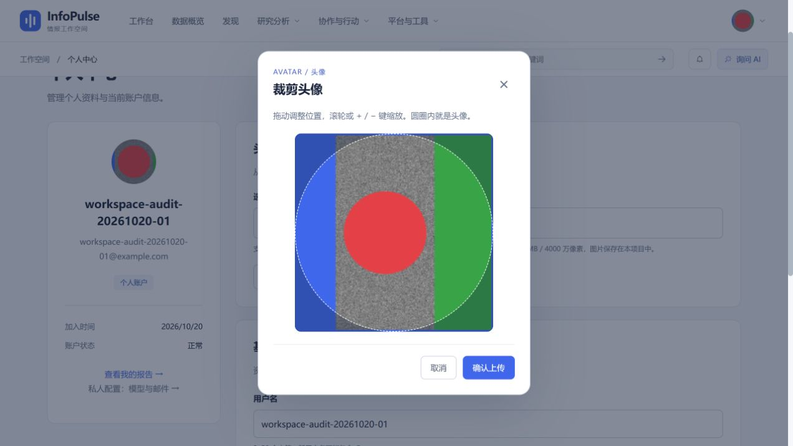

# R35：无数值控件的直接头像裁剪

日期：2026-10-20。根据用户进一步反馈，将 R34 的工具栏继续收敛为直接操作图片；本记录取代 R34 对当前界面的描述，历史测试证据保留。

## 已完成

- [x] 移除缩放百分比、加减按钮、重置按钮以及输出尺寸/文件体积参数行，不需要选择或输入任何数值。
- [x] 弹窗只保留说明、圆形裁剪预览、关闭、取消和确认上传。
- [x] 鼠标拖动调整位置，滚轮直接放大缩小；选图解码完成后自动聚焦预览，可直接用 `+` / `-` 缩放、方向键移动，Escape 取消。
- [x] 不接管 Ctrl、Meta、Alt 组合键，保留浏览器自身的键盘快捷键。
- [x] 保留图片边界约束、原图安全上限，以及裁剪编码后再校验上传体积的流程。没有修改上传接口或数据库。

## 本轮验证

- 前端 `npm test`：**78/78 通过**，其中头像裁剪 9 项；新增静态界面回归约束，防止数值控件和工具栏重新出现。该项是源码结构检查，不替代浏览器交互验收。
- `npm run build`：TypeScript、Vite 生产构建和入口包体预算通过。既有第三方 PURE 注释及大分包警告仍存在。
- 本地浏览器 `/profile` 使用验收账号及 6.48 MB 测试原图，确认弹窗没有数值调节控件；解码完成后焦点在预览。
- 实际操作滚轮放大、鼠标拖动、键盘 `+` 放大、`-` 缩小与方向键移动，再用滚轮缩小；截图中图片内容随操作改变，没有依靠内部组件状态模拟交互。
- 确认上传后显示“头像已上传并保存”，弹窗关闭，焦点回到选图入口。
- 本轮为前端交互修改，未重新运行后端专项，不将历史后端结果算作本轮验收。

## 边界

内部仍限制缩放范围并保持图片填满选区，但不要求使用者理解或选择缩放数值。保留单指拖动；尚未支持触屏双指捏合，移除按钮后不承诺纯触屏缩放体验。旋转、动画头像和全设备矩阵验收仍未覆盖。
