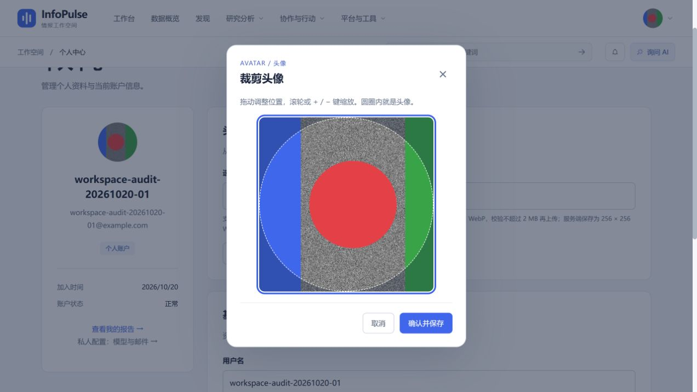
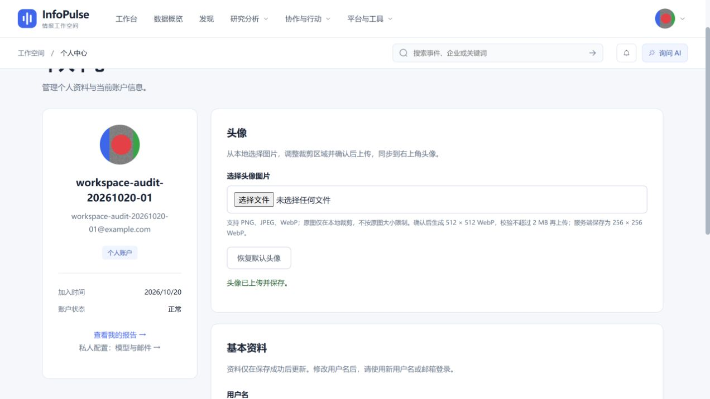

# R36-B：固定裁剪框、移动缩放图片（已完成）

本记录是当前头像交互契约，替代早期 PNG 输出、原图大小上限和数值调节方案。后端见 [R36-A](2026-10-20-avatar-webp-storage.md)。

## 已完成项

- [x] 选择图片只创建浏览器本地 Object URL，不上传，不按原图字节数或任意像素上限拦截。
- [x] 固定正方形裁剪框，图片等比例 cover，初始居中；移动的是图片而非裁剪框。
- [x] 鼠标拖动调整位置，滚轮以鼠标位置为中心缩放，范围为初始 cover 比例的 1～4 倍。
- [x] 拖动和缩放都限制边界，保证图片覆盖裁剪框；圆形遮罩预览最终头像可见范围。
- [x] 支持键盘 `+`/`-` 缩放、方向键移动，无需输入位置或缩放数值。
- [x] 点击“确认并保存”才创建 Canvas，并输出 512 × 512 WebP。
- [x] 编码完成后检查 MIME、非空及 2 MiB 上限，通过后仅上传裁剪成品。
- [x] 取消、关闭、编码失败和超限均不上传；编码中取消可丢弃晚到结果。
- [x] 重复确认保护，上传失败保留裁剪位置并显示错误，可重试；成功后同步个人中心与右上角头像。
- [x] 服务端重新校验并保存为 256 × 256 WebP。

## 实现与边界

对原图宽高 `W,H`，缩放 `z∈[1,4]`，选择的原图正方形边长为 `s=min(W,H)/z`；原图坐标 `x=(W-s)h, y=(H-s)v`，其中 `h,v∈[0,1]`。预览采用百分比定位原始 ``，导出使用同一矩形，因此预览和导出保持一致。普通拖动/缩放不执行 Canvas 编码。

原图只保留本地引用，关闭后释放 Object URL。保留 PNG/JPEG/WebP 类型和非空校验；超大原图仍可能受浏览器解码能力及可用内存限制，会明确提示读取失败，不承诺无限大图片可用。不支持 WebP 编码的旧浏览器会提示更新，不能用 PNG 冒充 WebP。

## 自动化测试

```powershell
cd frontend
npm test
npm run build
```

2026-10-20 工作区前端 83 项通过（其中 14 项裁剪测试），构建和 bundle 预算通过；后端头像与个人资料 21 项通过。裁剪测试覆盖横图/竖图/方图、1～4 倍限位、光标锚定、拖动边界、预览/导出一致、512 像素与 WebP MIME、2 MiB 边界、失败重试、取消和重复确认。

从 Git 暂存区导出的纯净前端副本再次测试：72 项全部通过，类型检查、生产构建及 bundle 预算通过。72 与 83 的差额来自工作区其他未提交功能的测试，本次分支未包含那些功能或测试；不以混合工作区通过代替独立分支验收。

组件测试运行真实处理函数和 Vue 响应式计算，替换浏览器图片解码与 Canvas 编码来验证时序；真实浏览器检查另外执行，不把模拟测试当作像素渲染验收。

## 本地浏览器验收

在 `http://127.0.0.1:15174/profile` 的专用测试账号验证：

1. 选择 6,483,314 字节的 1800 × 1200 PNG，可打开裁剪框，没有按原图的 2 MiB 限制拒绝。
2. 实际滚轮放大、鼠标拖动；读取渲染边界确认框始终为 320 × 320，图片覆盖框，没有露白。
3. 取消裁剪后，两个已显示头像的 Object URL 均未改变。
4. 再次选择，键盘放大和移动后确认，页面提示“头像已上传并保存”，右上角和个人中心头像都更新，解码尺寸均为 256 × 256。
5. 后端 HTTP 测试确认返回 `image/webp`，解码格式为 WEBP，且原图不作为保存内容。





## 后续可选优化

触摸屏双指缩放、可选缩放滑块、大图解码内存优化属于后续增强；本次不增加数值输入或复杂工具栏。当前鼠标滚轮、拖动和键盘即可完成流程。
