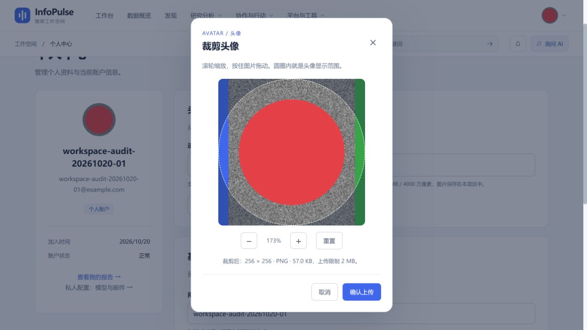

# R34：简化头像裁剪交互

日期：2026-10-20。范围：在 [R33](./2026-10-20-avatar-crop.md) 的本地裁剪基础上，移除复杂调节面板。

> 后续调整：用户希望完全不出现数值控件。[R35](./2026-10-20-avatar-direct-crop.md) 已进一步移除百分比、加减/重置工具栏和尺寸参数行，当前仅通过鼠标或键盘直接操作。本文以下为 R34 阶段的历史实现与验证，不是当前界面说明。

## 已完成

- [x] 去掉缩放、水平和垂直位置三个滑块；弹窗改为单列紧凑布局。
- [x] 鼠标滚轮向上放大、向下缩小，限制在 100%–400%；支持滚轮像素、行、页三种单位，触控板小幅滚动也能连续缩放。
- [x] 以鼠标所在位置为缩放锚点，保持该处图片内容稳定；到达图片边缘时限制选区，避免出现空白。
- [x] 按住鼠标拖动图片即可调整位置；保留触摸单指拖动及小号加减按钮作为补充入口。
- [x] 保留重置、取消、确认上传；预览获得焦点后，加减键缩放、方向键平移，Escape 取消。
- [x] 原图只在本地处理，仍在编码后按实际文件大小校验 2 MiB；原图安全限制、认证上传、元数据清除及存储流程不变。

## 实现与测试

`avatarWheelZoom` 统一滚轮单位与缩放范围；`zoomAvatarCrop` 计算鼠标锚点对应的选区；`panAvatarCrop` 计算拖动距离并约束边界。组件将滚轮、鼠标、按钮与键盘接到相同的坐标计算，避免多套交互结果不一致。

- 前端 **77/77** 测试通过；比 R33 新增 3 项，覆盖滚轮方向/单位/上下限、鼠标锚点稳定性、横竖方图边界与拖动方向。
- TypeScript、Vite 生产构建及入口包体预算通过；既有第三方注释与大分包建议仍存在。
- 浏览器使用本地验收账号及大于 2 MiB 的原图，实测滚轮放大至 149%、拖动后图案随鼠标移动、滚轮缩小至 100%；同时验证重置、按钮与键盘调整。
- 最后在 173% 缩放下生成 57.5 KB 裁剪图，点击“确认上传”后提示“头像已上传并保存”，弹窗正常关闭。
- 本轮只修改前端裁剪交互，不新增接口、依赖或数据库迁移。R33 的后端回归结果保留为前一阶段证据，并非本轮重跑。

```powershell
cd frontend
npm test
npm run build
```



## 边界

不支持双指捏合缩放、旋转或动画头像；手机可用加减按钮和单指拖动，本轮未做全移动设备矩阵验收。缩小到 100% 时保持图片填满头像，不提供留白或任意比例裁剪。
