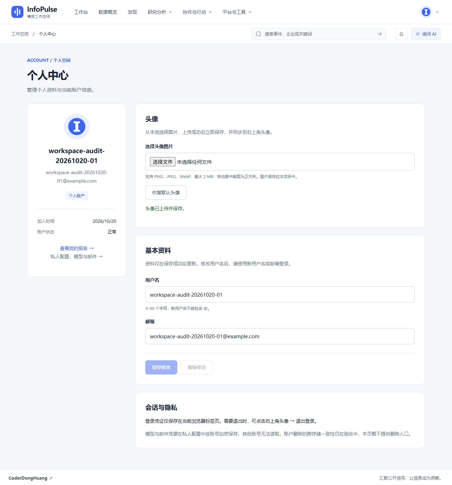

# R32：个人中心本地头像上传

日期：2026-10-20。范围：个人中心头像选择、存储、展示与恢复默认头像。

## 已完成

- [x] 移除头像地址输入框，改为选择本地图片；上传成功后立即保存，无需再点击基本资料的保存按钮。
- [x] 支持 PNG、JPEG、WebP；文件最大 2 MiB（界面显示 2 MB），像素不超过 1600 万；服务端按实际图片格式解码，不信任文件名或 MIME。
- [x] 根据 EXIF 方向校正、居中裁剪至 256 × 256，重新编码为 PNG，清除 EXIF 等原图元数据；原图不保存。
- [x] 头像保存到项目数据库 `user_avatars` 表，随数据库备份；不需要图床、对象存储或第三方密钥。
- [x] 上传、替换和恢复默认头像在成功响应前提交；旧版本链接失效，错误图片不覆盖原头像。
- [x] 图片读取需要当前账号认证，响应使用 `private, no-store`；前端用认证请求取得图片并管理临时对象 URL，不把令牌写进图片链接。
- [x] 个人中心和顶部账户菜单同步展示；独立上传不清空尚未保存的用户名、邮箱输入。
- [x] 原有 HTTP/HTTPS 头像展示与资料更新接口保留兼容性，但页面不再要求用户提供地址。

## 使用方式

进入右上角头像 → 个人中心 → 选择头像图片 → 调整裁剪 → 确认裁剪并上传。显示“头像已上传并保存”即已成功，可通过“恢复默认头像”改回用户名首字母。2026-10-20 后续 [R33](./2026-10-20-avatar-crop.md) 已将前端限制改为按裁剪后图片校验 2 MiB；原图安全限制为 20 MiB / 4000 万像素。下方 R32 测试数保留该阶段记录。

已有安装需要执行数据库迁移；本地 `scripts.public_server` 启动时自动执行：

```powershell
cd backend
python -m alembic upgrade head
```

本次迁移为 `20261020_0036`。不要在需要保留头像的数据库上执行降级：降级会删除头像表。无需额外配置项。

## 验证结果

- 后端头像专项 6/6 通过：三种格式与元数据清除、像素限制、上传/替换/恢复默认持久化、错误及超限文件、匿名拒绝与账号隔离、提交失败回滚。
- 既有个人资料事务与字段校验 12/12 通过；先执行 17 项组合测试，再补充元数据回归后重跑头像专项。
- 前端测试 69/69 通过，包含头像路径与文件校验；最终 TypeScript、Vite 构建及入口包体预算通过。构建仍有既有第三方 PURE 注释及分包体积建议。
- 临时空 SQLite 数据库完整升级、新迁移降级、再升级通过；真实本地数据库升级至 `0036` 并重新启动成功。
- API 契约快照校验通过，共 357 个路径；新增 `/api/v1/auth/me/avatar` 的 GET、POST、DELETE。
- 浏览器使用本地验收账号，完成选择图片上传、顶部/个人中心两处图片解码为 256 × 256、整页刷新保留、恢复默认、再次上传。未修改用户已有账号资料。

```powershell
cd backend
.\.venv-audit\Scripts\python.exe -m unittest tests.test_avatars tests.test_profile_transactions tests.test_profile_validation -v
.\.venv-audit\Scripts\python.exe -m scripts.api_contract_check
cd ../frontend
npm test
npm run build
```



## 边界与后续优化

- 手动裁剪与预览已在后续 [R33](./2026-10-20-avatar-crop.md) 完成；仍不提供旋转编辑或动画头像。此处 R32 的 2 MiB / 1600 万像素描述为服务端收到图片的限制，前端原图安全限制与最终输出校验见 R33。
- 此次数据库迁移实测使用 SQLite，未把结果扩展为 PostgreSQL 专项验收。
- 上传头像属于本人私人资料，不是公共可分享图片地址；旧外链头像仍受原站可用性影响。
- 本次只验收头像链路，不代表全站所有功能已完成验收。
