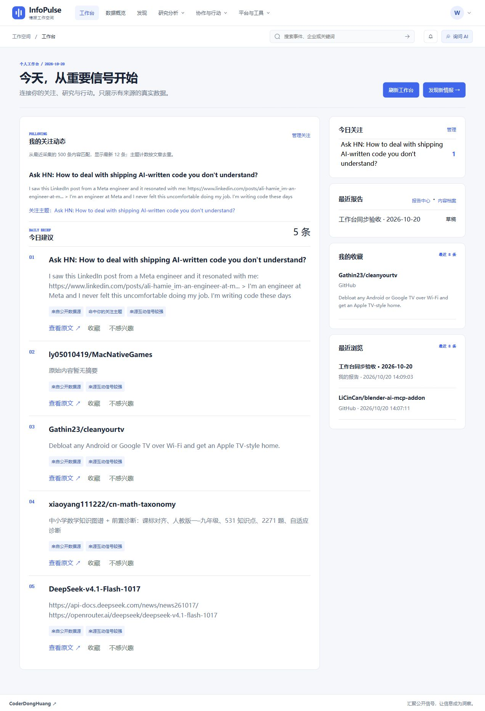

# R31：工作台最近浏览与最近报告同步验收

日期：2026-10-20。范围：本地自托管工作台的浏览记录、正式报告与已完成分析档案。状态：下列修复和验证已完成；不表示全站功能已达到稳定版。

## 故障与原因

1. 旧版仅在事件详情记录浏览。发现页原文、检索详情、正式报告与内容档案没有完整接入，正常打开内容也可能没有浏览记录。
2. 工作台的最近浏览只有静态标题，缺少来源、时间和可访问入口；返回标签页也不重新读取。记录写入与工作台读取同时发生时，刷新可能被正在进行的请求吞掉。
3. “最近报告”原先只查询正式 `Report`，未包含热点洞察、表达文案和事件脉络保存到 `AnalysisHistory` 的结果。原内容档案按钮进入新的工作流，无法直接阅读此前保存的结果。
4. 浏览与报告写入原先依赖数据库依赖项在请求结束阶段提交。新增显式提交，将“成功响应前已持久化”作为契约，避免立即读取仍看到旧状态。

## 已完成修改

- [x] 共用 `recordRecentView`：成功落库后通知工作台；失败明确提示，保留打开原文的能力。
- [x] 发现原文、检索详情/原文、工作台原文、事件详情、报告编辑器和档案详情接入浏览记录。
- [x] 浏览目标在服务器解析真实标题；重复浏览更新同一条记录和时间。不存在、已删除或他人私有目标不可新增；旧记录失效后显示不可访问，隐藏原私有标题及链接。
- [x] 工作台显示最近八条的标题、来源、时间及可点击入口。挂载、窗口重新聚焦、页面重新可见及本页浏览成功时读取；加载期间的更新排队再次读取。
- [x] 最近报告合并本人未删除正式报告与已完成的三类内容档案，按时间取最近八条，显示中文状态并分别链接报告编辑器或档案结果。
- [x] 新增本人档案详情接口及 `/history?record=…` 入口；展示保存的完整结果与生成参数。递归组件通过 Vue 文本插值展示数据，不执行结果中的 HTML。
- [x] 报告创建、修改、版本保存、恢复和删除在返回前提交；恢复旧版本更新最近修改时间。

## 自动化验证

后端专项：20/20 通过。

```powershell
cd backend
.\.venv-audit\Scripts\python.exe -m unittest tests.test_workspace_personalization tests.test_workspace_activity_durability tests.test_stage3 tests.test_reports tests.test_workflows -v
```

包括真实 HTTP 路由的浏览新增/去重/顺序/UTC、真实标题、删除后失效、账户隔离、合并已完成档案、档案详情所有权及删除后的工作台结果。额外使用临时文件 SQLite 和独立读连接验证报告创建、改名、浏览、保存版本、恢复与删除在处理函数返回时已可见。

前端：68/68 通过。新增回归验证成功写入后才发刷新事件、失败可恢复，以及工作台读取过程中发生的浏览更新不会丢失。`npm run build` 通过 TypeScript、Vite 和入口包体预算；保留现有分包体积建议及第三方 PURE 注释提示。

```powershell
cd frontend
npm test
npm run build
```

API 契约快照已更新并校验通过，当前 356 个路径；新增 `RecentViewRequest` 和档案详情 GET。该 GET 与既有档案删除共享同一路径，不增加路径总数。

```powershell
cd backend
.\.venv-audit\Scripts\python.exe -m scripts.api_contract_check
```

## 实际页面验收

入口：前端 `http://127.0.0.1:15174`，后端 `http://127.0.0.1:18081`。使用本地验收账号，不操作用户已有账户。

1. 全局检索 `OpenAI`，打开真实 GitHub 资讯 `LiCinCan/blender-ai-mcp-addon`，返回工作台。
2. 最近浏览显示文章标题、GitHub 来源、访问时间和正确原文链接。
3. 从报告中心创建“工作台同步验收 · 2026-10-20”，进入编辑器，确认已保存 v1，再返回工作台。
4. 最近报告显示该报告及“草稿”状态，最近浏览同时显示报告入口和访问时间。
5. 整页刷新后，上述两类记录仍存在。截图为刷新后的真实页面。



## 验证边界与后续优化

- 旧版未曾写入的浏览行为无法追溯补回；已存在的本人正式报告及已完成分析档案可直接读取，无需重新生成。
- 工作台展示最近八条；浏览接口返回最近三十条。完整历史管理、分页及跨标签页实时推送尚待优化；当前通过重新聚焦、重新可见和手动刷新更新。
- 内容档案列表仍保留现有分页边界，前端完整历史翻页另行优化。深链接详情不受第一页列表限制。
- 生成档案链路使用隔离数据库 fixture 验证；没有为截图向实际数据库伪造生成结果，也未调用付费模型。本次不证明第三方模型质量。
- 本次实际创建的是本地验收账号中的手工报告草稿，不含模型生成结论；未修改用户已有报告。
