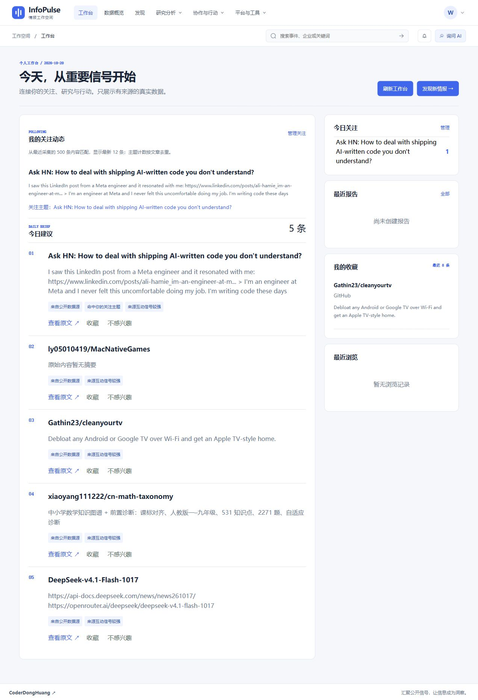

# 工作台收藏与关注链路修复

日期：2026-10-20。本记录仅验收收藏、话题/频道关注与工作台展示，不代表全项目回归完成。

## 问题与原因

1. 工作台收藏响应只有目标类型和 UUID，前端直接显示内部标识，读者无法识别文章。
2. 旧关注话题保存在浏览器 `infopulse.watchlist.v1`，工作台却查询服务端 WatchTopic，两条链路未连通。浏览器共享记录也没有账号归属。
3. 服务端已有频道关注接口，但发现页没有操作入口，工作台没有返回关注文章流。
4. SQLite 返回无时区的关注时间，浏览器按本地时间解释，显示偏移八小时。

## 完成范围

- [x] 收藏通过批量查询解析文章、事件、本人报告；显示标题、来源、摘要和目标链接。删除或无权访问的内容显示不可用提示，不回显其他账号报告标题。
- [x] 工作台显示最近 8 条收藏；收藏成功后重新读取工作台。
- [x] 关注话题统一通过当前账号的服务端 API 保存、读取与取消；失败保留现有列表并提示重试。
- [x] 账号切换清空前一账号列表；丢弃旧账号的延迟响应，防止串号。旧读取也不能覆盖刚完成的关注操作。
- [x] 旧浏览器记录由读者在“关注话题”页确认后导入当前账号；成功一条才移除对应本地记录，失败部分保留。原始附加字段不因失败丢失。
- [x] 发现页可关注/取消当前频道；工作台集中展示话题和频道匹配文章，标记匹配原因。
- [x] 主题计数对文章去重；停用主题不参与工作台匹配。API 的日期时间明确带 UTC 偏移。

## 验证结果

| 验证 | 结果与范围 |
| --- | --- |
| 后端 `python -m unittest tests.test_workspace_personalization tests.test_stage3 -q` | 7/7；包含真实 ASGI 请求与 SQLite，覆盖收藏解析、删除/越权隐藏、话题往返及去重、账号隔离、取消关注和频道链路 |
| 前端 `npm test` | 66/66；包含关注请求失败、账号切换的延迟读写、旧读写竞争、重复操作及旧记录部分导入失败保留 |
| 前端 `npm run build` | Vue/TypeScript、Vite 与 bundle 预算通过；仍有依赖注释和大于 500 kB 的分包提示 |
| `python scripts/api_contract_check.py`（backend 目录） | 356 条路径契约校验通过，本次没有修改契约快照 |
| 本机浏览器，真实前端 15174 / 后端 18081 | 使用独立本地验收账号：收藏 `Gathin23/cleanyourtv` 后工作台显示标题、GitHub 来源及摘要；关注全部频道显示真实文章；从实时热搜关注具体话题后，刷新关注列表仍保留，时间正确显示为本地 13:44 |

本次页面验证没有修改日常用户的私人配置，没有调用付费模型。四个公开数据源当前健康，单次正常不代表长期可用性。

另外已在页面取消验收账号的“全部”频道关注：返回工作台后，“我的关注动态”只保留所关注的 Hacker News 文章，确认话题匹配独立生效，并非频道全部数据掩盖问题。页面截图见文末。

## 使用方法与限制

旧版关注需要进入“关注话题”，确认记录属于本人后点击“导入到当前账号”。已被浏览器清理的本地记录无法恢复。新关注保存到账号后，回工作台即可查看匹配文章，也可点击“刷新工作台”。

目前关注动态从最新 500 条已采集、未删除内容匹配，最多显示 12 条；主题计数也只针对这 500 条，不是历史总数。匹配使用标题、正文和标签的关键词规则，英文有词边界，尚非语义推荐。全标题主题需要标题相符；想追踪更宽泛领域可关注对应频道。主题名称最多 120 个字符，超长旧记录保留并提示使用较短关键词。

- [ ] 关注动态历史分页与全量索引匹配。
- [ ] 可编辑关键词、启用/停用主题的完整界面。
- [ ] 完整收藏管理页、筛选、分页与失效记录清理。
- [ ] 旧关注在不同浏览器间的导出/导入、长期真实来源质量与推荐效果评估。

## 页面证据

