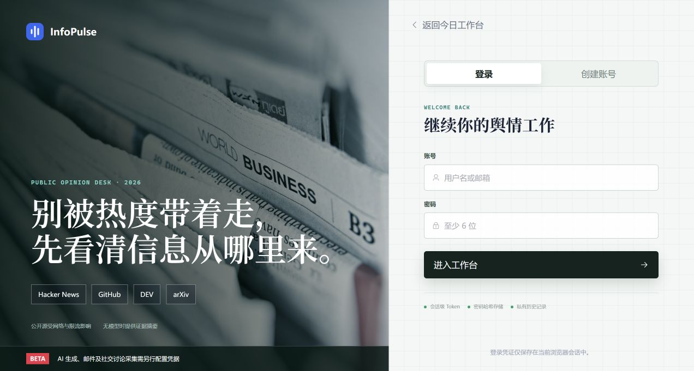
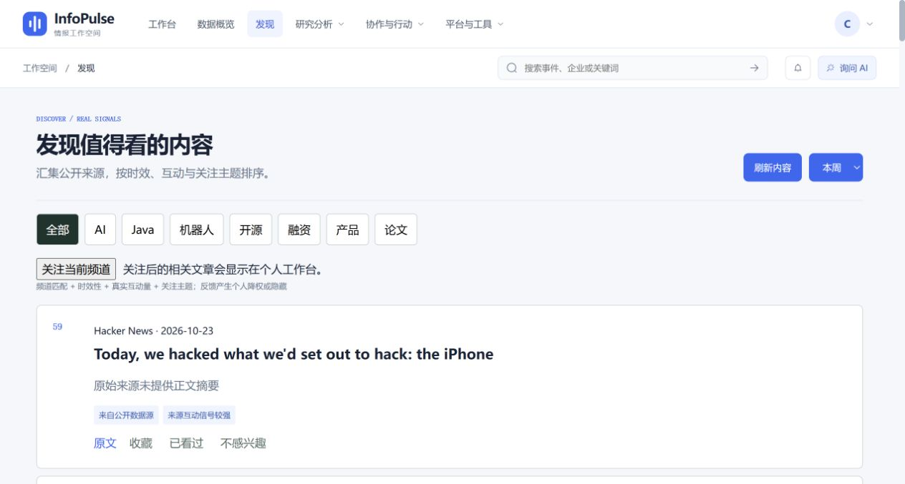
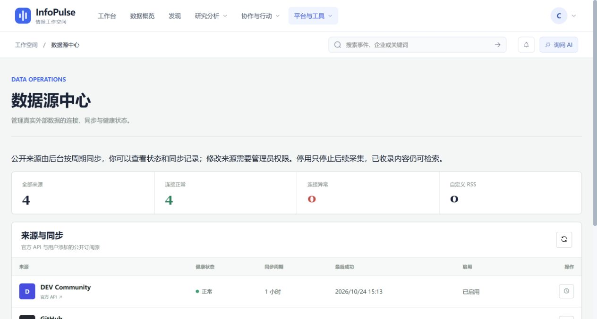

# 2026-10-24 开源学习就绪与快速启动验收

## 完成状态

- [x] 干净项目环境安装和 Edge 注册、退出后登录、发现、来源、无模型摘要及引用详情验收。
- [x] GitHub Issue 表单、PR 模板、CODEOWNERS、beta 发布说明草案和路线图。
- [x] README、登录界面与能力矩阵说明公开数据、演示内容和外部凭据边界。
- [x] 前端 Agent/编排逻辑及图编辑状态、后端工作流图校验/分支选择拆分，并补回归测试。

适合开源学习和本地 beta 自托管。上述完成范围不包含全站组件拆分，也不代表公网生产验收完成。

## 干净环境与计时

在 Windows 上导出已跟踪源码到独立目录，从没有 `.venv`、`node_modules`、`.env` 和数据库的项目开始，创建新 Python 虚拟环境，真实执行 `pip install -r requirements-base.txt` 和 `npm ci`。使用独立 `.public-local` 数据和随机密钥，没有复用原工作目录的运行库、账号或数据库。

Python 3.12.14、Node.js 22.19.0、Git 和 Edge 已预装；本机 pip/npm 下载缓存未清除，pip 使用本机配置的清华镜像。计时不包含安装这些先决软件或获取源码。因此这是**干净项目环境验收，不是全新物理电脑或冷缓存网络基准**；慢网、上游故障可能超过十分钟。

| 阶段 | 北京时间（2026-10-24） | 结果 |
| --- | --- | --- |
| 创建虚拟环境并开始依赖安装 | 15:08:08 | 两端安装并行 |
| npm 安装完成 | 15:11:04 | 锁文件安装成功 |
| pip 安装完成 | 15:12:09 | 新环境 `pip check` 通过 |
| 前端可访问 | 15:13:06 | 后端健康，开始浏览器操作 |
| Edge 完成演示流程 | 15:17:17 | 从开始约 **9 分 9 秒** |

遵循 README 的启动方式；因原实例占用默认端口，独立验收使用后端 `18082`、前端 `15175`，并显式设置 `VITE_API_PROXY_TARGET=http://127.0.0.1:18082`。README 默认仍为 `18081` / `15174`。无需激活 PowerShell 脚本，直接调用虚拟环境 Python，避免执行策略影响新用户。

## Edge 实际操作证据

1. 从登录页切换注册，以隔离测试账号 `clean-start-20261024` 注册成功，自动进入工作台；全过程通过页面操作，没有 API 代建账号。
2. 从账户菜单退出，再使用同一账号通过登录表单进入工作台。
3. 发现页显示 89 条近期候选内容；来源中心显示 DEV Community、GitHub、Hacker News、arXiv 四源健康及实际同步时间。
4. 在 Agent 选择并发送“总结今天 AI 行业的公开情报”，返回基于 20 条可访问证据的摘要，页面提示未配置模型时提供证据摘要。
5. 最终重构后再次点击引用，详情展示文章标题、来源、摘要和原文链接，关闭后回到会话。此步骤属于计时结束后的补充冒烟验收。

| 登录与能力提示 | 注册后的工作台 |
| --- | --- |
|  |  |

| 公开内容 | 四源健康 |
| --- | --- |
|  |  |

截图仅含隔离账号和公开文章，不包含密码、令牌或真实提供商凭据。运行目录、数据库和原始日志不提交。

## 发现与处理

- 旧 `frontend/.env.local` 可残留错误代理端口：README 明确命令行覆盖方式，避免注册请求发往旧服务。
- 登录页原有社交平台和模型标签容易暗示默认可用：改成四个公开来源、限流说明和凭据提示。
- arXiv API 本次请求失败后，官方 RSS 回退于 15:13:56 返回 200，来源保持健康；这只证明本次回退可用，不保证上游持续可用。
- Agent 抽出逻辑后，DOM 引用需显式绑定，已修复输入框/消息区/历史按钮引用；补焦点、路由和生命周期回归。
- 工作流图非法节点、边和配置此前可能抛类型错误，现统一为校验错误，并保留原运行时导入兼容。

## 数据与凭据边界

工作台、发现和来源使用实际公开采集内容，不注入演示文章。仓库截图、测试 fixture 和隔离账号用于学习验收，不代表真实用户业务。无 LLM 时 Agent/日报提供规则或证据摘要；工作流 agent 节点缺少模型时明确失败。LLM/视觉/转写、SMTP 由用户在私人配置提供；S3 由部署者配置服务端环境。SSO/SCIM、社交 Cookie/token 和可选 GitHub token 均需使用者自行配置，不随仓库提供。详见[能力矩阵](../32-capability-matrix.md)与[配置指南](../29-configuration-guide.md)。

## 结构与验证

- `useAgentView.ts` 管理会话视图生命周期、路由和交互，`AgentView.vue` 保留模板与 DOM 绑定。
- `useOrchestration.ts` 管理编排 API/租户状态；`useWorkflowDesigner.ts` 单独管理本地图编辑。
- `workflow_graph.py` 独立处理图校验与分支选择，无数据库、worker 或模型依赖；原 `orchestration` 导入路径继续可用。
- 前端 **93/93** 测试通过，含新增 6 项会话/图编辑行为测试；TypeScript、生产构建和 bundle budget 通过。
- Python 3.12 后端图、编排、审计专项 **20/20** 通过，覆盖分支、非法图、运行时与权限/出站请求回归。此次本机没有宣称完整后端套件通过；完整跨平台回归由 PR 发布门禁执行。
- 后端 unit 分层 **60/60** 通过，完整发现 324 项、每项确定性归类；`compileall` 通过。沙箱内首次运行在临时目录清理时受权限限制，沙箱外重跑正常退出。
- 社区模板及首批前端拆分已随 [PR #98](https://github.com/CoderDongHuang/InfoPulse/pull/98) 合并；本报告的新增图模块及补充证据随 [PR #99](https://github.com/CoderDongHuang/InfoPulse/pull/99) 合并至 `b9a428a530fa2b690269219c889e000b4d9dcefb`。PR #99 的 26 项检查全部通过，包括 Linux/Windows 分层回归及完整性门禁、容器、浏览器产品、依赖审计与 CodeQL；没有以本机专项代替完整 CI 结果。

大型页面的模板组件进一步拆分、真实 LLM/SMTP/S3 提供商、备份恢复、可观测性和长期稳定性仍按[路线图](../30-open-source-roadmap.md)保留待办。
