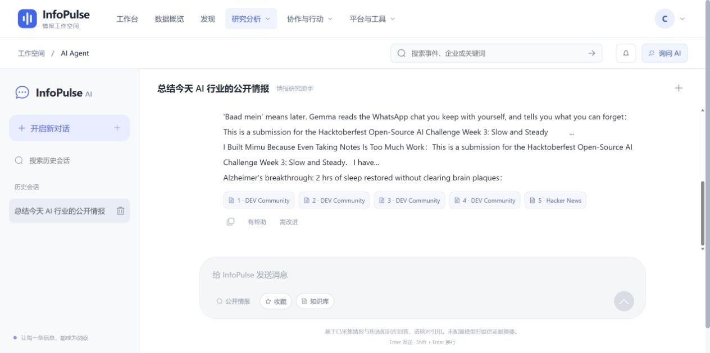

# Agent 的答案从哪里来：证据摘要、引用与会话状态

更新日期：2026-10-24。[返回主文](./infopulse-open-source-engineering.md) · [专题索引](./README.md)

本地启动 InfoPulse 后，即使没有模型密钥，也可以在“询问 AI”得到带引用的摘要。这不表示仓库偷偷提供了免费模型，而是该入口实现了确定性的证据降级。理解它如何工作，也能帮助判断配置模型后哪些风险仍然存在。

## 从可访问内容开始组织答案

[agent_service.py](../../backend/app/services/agent_service.py)根据会话关联事件、用户指定内容、本人收藏与查询词收集公开资讯，并调用带用户上下文的私有知识检索。进入答案阶段的是已获取的证据行，不是任意网页链接列表。当前查询和数量有界，不是全网搜索，也不能保证检索召回全部相关信息。

无模型时，`evidence-rules-v1` 从证据标题与片段组织回答，并附引用索引；没有证据则返回无法给出事实性回答的说明。它能让使用者检查本地内容与引用链路，却没有承担跨文章推理、事实核查或复杂观点比较的能力。

配置兼容模型后，服务把问题与证据交给模型，要求返回答案、事实条目和引用索引。代码过滤没有合法索引的条目；没有有效条目时返回证据不足提示。索引合法只是结构约束，模型仍可能曲解原文，整体回答也没有被形式化地逐句证明。

因此，评价结果至少要分开看：检索是否找到正确文章，引用是否指向相应材料，原文是否支持该句话，原文自身是否可靠。这些问题不能由“模型返回成功”或“引用按钮可点击”一次回答。

## 引用需要能回到具体材料

[Agent API](../../backend/app/api/agent.py)将消息与公开内容引用、私有知识片段引用分别持久化。公开引用可以展示来源、摘录与原文链接；私有引用带文档、页码或段落等定位，且读取时考虑文档当前版本与删除状态。入口先检查会话所有权，不能仅凭猜到会话 ID 访问他人的会话。

前端引用详情展示相关材料，外链只接受没有 URL 用户名密码的 HTTP/HTTPS 地址。外链协议过滤有助于避免危险链接执行，不能代替对原网站真实性的判断。

截图来自 2026-10-24 隔离账号验收，当时回答使用 20 条可访问证据。点击引用和关闭详情在最终重构后另行复查，不属于 9 分 9 秒启动计时内的全部动作。现场操作证明交互可用，没有检验付费模型质量，也没有证明任意问题都有充分证据。

## 流式输出还需要处理迟到消息

切换会话时，旧请求可能仍在返回。如果只维护一个全局 `draft`，迟到的文本、详情请求或错误就可能覆盖新会话。停止按钮也不能只改变视觉状态，让旧回调继续写入。

[useAgentChat.ts](../../frontend/src/composables/useAgentChat.ts)为请求维护递增序号。切换、停止或销毁时使旧序号失效；流式回调同时检查序号与当前会话，过期结果不能继续写入。发送失败恢复输入；读取历史或知识库失败有各自提示，不把空列表静默当作成功。

会话关联事件也有所有权：已经加载的会话决定其事件上下文，不能被 URL 残留的旧 `event_id` 覆盖。新建普通会话时同步清理旧参数，同时保留其他查询条件。[useAgentView.ts](../../frontend/src/composables/useAgentView.ts)负责这些路由与视图行为，底层会话流留在 `useAgentChat`。

## 抽出逻辑后仍需验证真实 DOM

将代码移入 composable 不会自动保证模板引用继续工作。消息区滚动、输入框聚焦和历史按钮焦点恢复，都需要 `.vue` 模板将真实 DOM 显式绑定回对应 ref。只给状态函数一个假的 `focus()`，无法证明页面已经绑定正确。

本轮既补了[会话回归](../../frontend/tests/agent-chat.test.mjs)和[视图回归](../../frontend/tests/agent-view.test.mjs)，也实际通过 Edge 检查新会话焦点、快捷问题填入、Enter 发送以及引用打开/关闭。Enter 发送逻辑还区分 Shift+Enter 和输入法组合状态，避免中文选词时误发。

这些检查覆盖了明确交互，并不代表全站所有按钮、移动输入法与网络故障组合都已完成验收。更严格的 DTO、组件拆分和错误场景仍在[路线图](../30-open-source-roadmap.md)。

## 聊天入口与工作流节点不能混为一谈

聊天和日报的已实现位置可以提供规则摘要；编排中的 `agent` 节点缺少模型时明确失败，不使用同一降级冒充任务执行成功。图片和音频也需要实际支持相应协议的服务与 worker，不能由文本模型连接成功推断它们可用。

使用者可以先用公开内容验证引用，再在[私人配置](../29-configuration-guide.md)中添加自己的模型，分别检查权限、费用、任务结果与证据。公开数据默认可用、协议适配已测试、真实服务已验收，是不同层次的结论。
