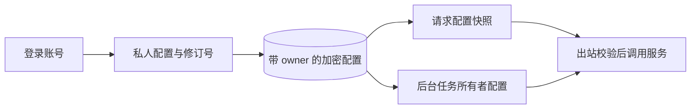

# 登录成功以后：认证事务与私人服务配置的边界

更新日期：2026-10-24。[返回主文](./infopulse-open-source-engineering.md) · [专题索引](./README.md)

认证不止是生成一段 JWT。客户端拿到令牌时，另一个请求可能马上开始；如果会话仍未提交，第二个数据库连接就可能看不到它。私人服务配置还有另一个问题：谁触发任务，与任务应该使用谁的模型额度，并不总是同一件事。

InfoPulse 将这两类问题放在明确的所有权与事务边界上处理。当前已实现登录限流、会话撤销、refresh 单次消费和按账户隔离的私人配置。旧历史文章中“尚未实现”的段落只反映早期状态。

## 成功响应应该发生在提交之后

早期实现将注册、登录、SSO exchange 和 refresh 的提交交给请求依赖清理阶段。ORM 的 `flush` 可以拿到主键，却不等于其他连接能读到记录；若提交在成功响应之后失败，客户端已经得到无法兑现的凭据。

现在这些 API 先构造令牌响应，再 `await db.commit()`，提交成功才返回。构造响应也不能简单放在提交之后：若签名失败，先提交就可能留下客户端从未拿到的会话。服务层不自行提交，保留注册用户、租户成员关系与会话的组合事务。源码见 [auth API](../../backend/app/api/auth.py) 和 [auth service](../../backend/app/services/auth_service.py)。

refresh 通过带旧 `jti`、有效会话和过期条件的数据库更新来领取新的 `jti`，旧值不能再次消费。会话撤销也必须持久化后再向客户端确认。JWT 签名、会话状态和提交成功共同构成认证结果，不能只检验字符串能否解码。

[认证持久性专项](../audits/2026-10-13-auth-durability.md)使用真实文件 SQLite，让 writer 保持打开，在没有测试端手工提交、没有请求清理的条件下，由独立 reader 检查令牌可见性；还注入提交失败，检查不会产生成功凭据或错误消费。它比单个连接内的断言更能暴露响应时序问题，但没有替代所有 PostgreSQL、并发和真实身份提供商验收。

## 登录限流也需要准确解释

当前数据库共享计数避免每个 worker 拥有独立登录额度。生产算法采用固定时间窗口，测试应证明这个算法，而不能默认它是任意滚动 60 秒。

一次 Windows 回归曾在第 11 次登录仍得到 200：首个请求发生在 10:18:59.956，后续请求跨入下一分钟，实际分属两个窗口。修复测试时只固定限流模块的时钟，保留真实数据库并发计数，分别验证同窗口额度耗尽和下一窗口恢复，没有放宽阈值或靠重试掩盖失败。[R10 记录](../audits/2026-10-13-rate-limit-clock.md)保留了日志、边界和回归方式。固定窗口边界可能出现相邻窗口的集中突发，不能把“已有登录限流”解释成所有滥用场景都已解决。

## 私人配置跟随任务所有者

本地公开数据主链不需要模型密钥。需要模型或邮件时，登录账号在 `/settings` 保存自己的信息；S3 和企业身份基础设施仍由部署者配置。保存操作不会自动创建外部账号、开通模型权限或购买额度。

配置按账户加密，接口不回显密钥，浏览器不把服务密钥写入 localStorage/sessionStorage。空密码框表示保留，显式清除才删除；更换服务目标必须重新输入或清除密钥，避免原服务凭据被转发至新地址。修订号条件更新会拒绝过期写入，减少多标签页静默覆盖。

HTTP 请求绑定账号自己的设置快照，流式响应继续使用该快照。后台媒体、编排和邮件则根据持久化资源所有者读取配置，不继承恰好触发调度的用户，也不把实例全局 LLM/SMTP 凭据分发给普通账号。正在执行的调用不会随页面修改热切换。源码入口是 [service_settings.py](../../backend/app/services/service_settings.py)，完整交互与隔离证据见[私人配置专项](../audits/2026-10-18-private-configuration.md)。

## 加密与连接测试各有边界

服务器管理员掌握主密钥，仍能解密私人配置；这是账户隔离与静态加密，不是管理员不可读的存储。模型调用会把必要的输入和证据发送到使用者选择的服务商。备份必须同时考虑数据库、文件与解密密钥，不能通过随意替换主密钥来“修复”无法读取的配置。

模型出站限制公开 HTTPS 端点，校验并固定公网地址，保留原始 Host/TLS 身份，不随重定向或环境代理转发凭据。SMTP 使用 465 TLS 或 587 STARTTLS。限制的实际代价是当前私人配置不支持直接连接本机 Ollama、内网模型网关或依赖环境代理的服务。支持这些场景需要独立的管理员可信端点方案与测试。

| 页面反馈 | 实际证明 | 还需要验证 |
| --- | --- | --- |
| 已配置 | 必需字段存在 | 网络、权限、额度和协议 |
| 文本模型测试成功 | 该次文本请求可完成 | 图片、转写及实际业务质量 |
| SMTP 测试成功 | TLS、可选认证和 NOOP 成功 | 发件权限、实际投递、收件箱与反垃圾策略 |
| 配置保存成功 | 当前账号修订已持久化 | 正在运行的旧调用不会因此热切换 |

真实 SSO/SCIM、强制 MFA、主密钥在线轮换、各提供商兼容性与每用户实际用量控制仍有待办。当前不可实施的强制 SSO/MFA 策略不会因界面开关存在就被视作已生效。最新范围见[能力矩阵](../32-capability-matrix.md)和[配置指南](../29-configuration-guide.md)，阅读旧审计时应保留其日期和验证范围。
