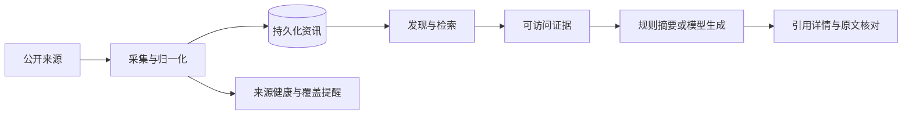

# 从公开信息到可追溯摘要：InfoPulse 的开源工程实践

更新日期：2026-10-24。面向希望本地运行、阅读源码或参与贡献的开发者。本文描述公开数据主链的 beta 状态；`v0.1.0-beta` 发布说明仍是草案，不代表已经发布稳定版。

当一个信息工具能采集文章、展示图表、调用模型时，演示通常已经足够热闹。但使用者还会遇到更具体的问题：来源限流后今天的内容还有多少？没有模型密钥时页面会发生什么？答案中的引用能否打开？看到“保存成功”后，刷新页面是否还在？

InfoPulse 的开源整理围绕这些问题展开。它是一个面向公开信息研究的 AI 情报与舆情工作台，使用 FastAPI、SQLAlchemy Async、Vue 3 和 TypeScript。目前最适合学习和本地自托管的是这条路径：**同步公开来源，检索和整理内容，生成带引用的证据摘要，再回到原文核对。** 企业集成、多模态与实验治理模块有各自的实现边界，不能仅凭菜单和接口数量判断成熟度。

原来的长文累积了 82 个编号章节，适合追溯工程过程，却让新读者难以辨别历史和现状。本篇重新组织阅读入口；完整正文另存为[工程历史记录](./infopulse-engineering-history.md)，具体故障和实现拆为四篇[专题文章](./README.md)。

## 先跑通一条真实路径

第一次运行不必先购买模型服务。持久化资讯主链支持 Hacker News、GitHub、DEV Community、arXiv 和 RSS；其中四个内置来源已有真实联网验收。工作台、发现页与来源中心读取实际采集内容，公开主链不会为了填满界面注入演示文章。网络失败或暂无匹配内容时，页面应保留相应提示。

微博、B站和贴吧讨论工具采用另一套 crawler、临时样本与历史链路。它们没有全部汇入持久化资讯管道，最小安装也不会自动开启浏览器讨论采集。这一区别会影响你在哪里能搜到内容，以及需要配置哪些依赖。


图为 2026-10-24 隔离验收账号的工作台。截图不是线上服务承诺，也不能证明你此刻会采到相同文章。

### 两个终端启动，然后从注册开始

预先安装 Python 3.11/3.12、Node.js 22 LTS、Git 和浏览器，克隆仓库后进入项目根目录。以下为 Windows PowerShell 命令；完整配置、已有环境升级和其他入口见[README](../../README.md#无需密钥的公开数据使用入口)。

终端一：

```powershell
cd backend
python -m venv .venv
.\.venv\Scripts\python.exe -m pip install -r requirements-base.txt
.\.venv\Scripts\python.exe -m scripts.public_server
```

终端二：

```powershell
cd frontend
npm ci
$env:VITE_API_PROXY_TARGET = 'http://127.0.0.1:18081'
npm run dev -- --host 127.0.0.1 --port 15174 --strictPort
```

打开 [本地工作台](http://127.0.0.1:15174/)，注册自己的账号，再退出并重新登录。进入发现页等待同步、刷新内容，到数据源中心核对来源健康与同步时间。接着打开“询问 AI”，发送“总结今天 AI 行业的公开情报”，并点开回答下方的引用。

后端启动器自动迁移独立 SQLite，将随机密钥、数据库和知识文件保存在 `backend/.public-local/`，不读取已有 `.env`，不覆盖原开发数据库。前端命令显式覆盖代理，避免旧 `.env.local` 指向其他实例。两个终端需要保持运行；Vite 本地服务器不是公网部署方式。不要为排查空数据随意删除运行目录，其中的主密钥还用于解密私人配置。

我们在独立导出的源码目录里，从没有 `.venv`、`node_modules`、配置和数据库的项目开始安装，实际使用 Edge 完成注册、退出、登录、发现、来源和摘要操作，共 **9 分 9 秒**。Python、Node、Git、Edge 已预装，pip/npm 下载缓存未清空，pip 使用本机清华镜像；这不包含安装先决软件或获取源码，不能当作全新物理电脑的冷缓存基准。该次发现页有 89 条候选内容，Agent 使用 20 条可访问证据；数量取决于当时数据，不是固定演示输出。[验收记录](../audits/2026-10-24-open-source-readiness.md)保存了计时条件和截图。

## 数据源会失败，系统需要解释影响

最初的 arXiv 覆盖提醒直接暴露了一个典型边界：上游返回 HTTP 429，表示请求受限。简单循环重试会增加请求量；完全隐藏错误又会让读者误以为数据完整。

当前采集器解析 `Retry-After`，在同一事件循环的采集器之间共享请求间隔、缓存和端点冷却；请求至少间隔 3 秒，成功结果缓存 5 分钟。API 失败时尝试相同分类的官方 RSS；两个入口都失败就保留已有论文并报告无法更新，不用过期缓存冒充本次成功。多个进程并不共享这些限流状态，因此部署时仍须避免重复启动采集 worker。

2026-10-24 的实际启动中，API 请求失败后官方 RSS 返回 200，来源得以恢复。这证明了那次回退可用，不能保证以后每次都成功。RSS 是每日发布订阅，与 API 按提交时间排序的结果可能不同；“有数据”也不能等同于“覆盖全部最新研究”。具体实现与故障测试见[采集容错专题](./public-source-resilience.md)。



这里的图描述资讯主链，没有把讨论 crawler 或全部实验模块画成已经统一的生产管道。

## 无模型摘要有价值，也有明确上限

Agent 先获取可访问内容，再组织答案与引用。没有 LLM 凭据时，它可以返回确定性的证据摘要；没有足够证据时明确说明无法给出事实性回答。配置模型后，必要的提问和证据会发往使用者选择的服务商。引用索引校验能排除越界引用，但不能证明模型对原文的解释正确，读者仍需核对事实。


这张截图来自无模型验收，展示规则摘要与引用交互，没有使用付费模型。它也不代表所有分析模块都具备同样降级：工作流中的 `agent` 节点缺少模型会明确失败。详细数据路径、流式会话和交互验证见[Agent 与引用专题](./agent-evidence-and-boundaries.md)。

## 凭据配置决定哪些服务真的发生

为帮助学习者判断默认体验，当前能力按依赖区分如下。这里的“无需密钥”仍以网络可用、来源允许访问和相应进程运行作为前提。

| 能力 | 本地默认体验 | 额外依赖与验证边界 |
| --- | --- | --- |
| 四源资讯、发现、搜索、工作台 | 实际公开采集与账户活动 | 上游可限流；来源健康不证明长期完整覆盖 |
| Agent、日报 | 已实现位置提供规则或证据摘要 | 模型生成需私人 LLM 配置；工作流 agent 无模型失败 |
| 文本、图片、转写 | 无凭据时待配置或不可用 | 用户自己的兼容模型、权限与额度；媒体还需 worker，视频需 FFmpeg |
| 邮件 | 站内通知可独立使用，邮件不伪造送达 | 私人 SMTP；连接测试不发送邮件，送达须单独核对 |
| S3、企业身份、平台讨论与连接器 | 按模块配置或保留能力入口 | 部署者/使用者提供授权与凭据，未完成全部真实提供商验收 |
| 阶段 20–29 治理实验 | 规则、模拟与声明记录 | 不代表已部署分布式共识、形式化验证或完整删除证明 |

LLM、视觉/转写和 SMTP 从右上角“私人配置”进入，按账号加密保存，请求和后台任务按所有者使用配置，不向普通注册用户分发实例全局模型额度。S3 属于部署者配置。服务器管理员掌握主密钥，仍可能解密数据，因此应在信任的实例录入凭据；静态加密不等于对管理员保密。

认证方面，公开注册默认非管理员，已有数据库登录限流、可撤销会话和 refresh 单次消费。早期长文关于“尚未实现”的描述已归入历史记录。当前实现与仍待验证的 SSO/MFA 边界见[认证与私人配置专题](./identity-and-private-settings.md)和[能力矩阵](../32-capability-matrix.md)。

## 测试证据要说明证明了什么

项目的验收同时包含自动化和实际界面操作。下表是 **2026-10-24、PR #99 合并版本**的证据快照，不是永远不变的测试计数。

| 证据 | 已记录结果 | 结论的范围 |
| --- | --- | --- |
| 前端测试、类型与构建 | 93/93，通过 TypeScript、生产构建和 bundle budget | 覆盖已编写交互与状态回归，不代表所有按钮/浏览器组合 |
| 后端本机专项 | 图、编排、审计 20/20；unit 分层 60/60 | 本机没有据此宣称完整后端套件全部执行 |
| 后端发现与契约 | 发现 324 项并确定性归类；357 条 API 路径契约 | 发现数不是执行数，路径数不是业务覆盖率 |
| GitHub PR #99 | 26 项检查通过，含跨平台回归、覆盖完整性门禁、容器、浏览器与安全检查 | 证明该提交在 CI 环境通过，不替代真实外部账号与运行现场验收 |
| Edge 快速启动 | 干净项目环境 9 分 9 秒，注册、登录及公开数据流程完成 | 有预装运行时和下载缓存；上游、网络与设备不同会改变耗时 |

对应改动见 [PR #98](https://github.com/CoderDongHuang/InfoPulse/pull/98) 和 [PR #99](https://github.com/CoderDongHuang/InfoPulse/pull/99)。单纯增加测试数不会自动改善可维护性；这次还拆出了 Agent 会话视图、编排状态、本地图编辑和后端纯图校验模块，并保持旧运行时导入兼容。图错误现在统一走校验错误，前端抽离后的 DOM 引用也有实际焦点和引用交互验证。模块如何分工、为何还要继续拆组件，见[测试与渐进重构专题](./verification-and-refactoring.md)。

## 项目现在适合怎样使用

目前可以把 InfoPulse 作为公开信息研究的本地 beta，或作为学习异步 API、采集容错、账户隔离、引用、worker 和 CI 的工程案例。它有比单页演示更完整的运行与验证记录，也仍有清晰的待办。

后续优先的是实际 LLM/SMTP/S3/身份与消息提供商验收、备份恢复和主密钥轮换、长时间运行与监控负载验证，以及前端组件拆分、DTO 收紧和其余 worker/PostgreSQL 恢复矩阵。已有运维脚本与部署清单不等于这些现场工作已经完成。完整状态保留在[路线图](../30-open-source-roadmap.md)。

外部贡献可以从一个具体失败、一段可复现流程或一个较小的模块开始。仓库已有 [Issue 表单](../../.github/ISSUE_TEMPLATE)、[PR 模板](../../.github/pull_request_template.md)、[CODEOWNERS](../../.github/CODEOWNERS) 和[贡献指南](../../CONTRIBUTING.md)。报告问题时写明提交、启动入口、复现步骤与预期；提交修复时说明验证范围，避免把模拟成功写成真实服务成功。

## 继续阅读

- [专题索引](./README.md)：按问题选择阅读路径。
- [公开采集与 arXiv 429](./public-source-resilience.md)：请求节流、官方 RSS 回退与覆盖语义。
- [认证与私人配置](./identity-and-private-settings.md)：成功响应前提交、会话与凭据的所有者边界。
- [Agent 与引用](./agent-evidence-and-boundaries.md)：证据摘要、流式交互和模型能力限制。
- [测试与渐进重构](./verification-and-refactoring.md)：测试分层、兼容性和模块拆分。
- [工程历史记录](./infopulse-engineering-history.md)：保留原 82 个编号章节，仅用于追溯。
